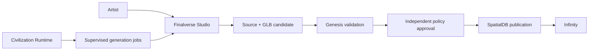

# S0 architecture

Finalverse Studio is the Blender fork in `~/Finalverse/studio`, not an add-on
masquerading as a separately built editor. Upstream is 5.4.0 alpha at
`0f5a1ae067d9785d2c106a887c94a0c96c3239a4`.

`bl_ui.finalverse_studio` owns the authoring sidebar, persistent authoring IDs,
scene inspection, bounded creation-history receipts and export operators. It
reuses actual Blender mesh/render/save/glTF APIs. The dedicated workspace has a
3D view, assistant sidebar, outliner, properties and asset browser. Other Blender
workspaces remain available. Registration is part of the fork's normal startup;
no installed upstream application is patched.

`finalverse.studio-candidate/v1` carries editable source and GLB references, byte
lengths, hashes, authoring IDs and explicit glTF Y-up/metre convention. IDs are
editor identities, not resident UUIDs or MutSea instance identities. Existing
files refuse overwrite. Integrity checking does not certify geometry, ownership,
licensing or permission to publish. Genesis must perform its actual admission.

A separate, trusted host descriptor pins the built Studio executable. The Core
adapter retains the existing Genesis worker/watchdog/resource limits and cleared
environment. The sandbox admits only the explicitly selected app bundle in
addition to the established worker/template/scratch. No model chooses this path.
Generation receives no resident memory, credentials, grants or world database.

Model registry, AI orchestrator, scene intelligence beyond the local index and
MCP are S1 extension boundaries. They are not speculative empty services in S0.
S0 does not run inference, accept arbitrary scripts from a model or publish assets.
Human artists can still use Blender's normal Python console; that editor feature
is distinct from the restricted autonomous worker boundary.
