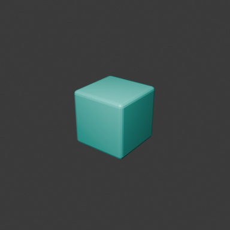

# S1 local engineering acceptance

S1 is implemented and its local engineering checks pass on isolated
`feat/studio-s1`, including the final desktop visual check, which was previously
blocked by a locked Mac. On 2026-11-04 the installed S1 app ran in a real
interactive window (not `--background`). It produced a real 12-operation Gemma
proposal, showed the full plan in the Text Editor, executed after approval,
cancelled at step 4/12 with no further steps, and cancelled an in-flight provider
child. Albert's added S1 requirement (switchable Maple plus custom AI providers
with Keychain credentials) is implemented and tested in the rebuilt S1 provider
app. See [providers](#model-providers-maple-and-custom). User acceptance remains
Albert's decision. No push, merge or deployment occurred.

## Exact sources and artifacts

| Input/output | Revision or location |
| --- | --- |
| Accepted S0 Studio source | `24d1acf06b55945bed5d247bd6e5184906bf4150` |
| Compiled S1 implementation | `7e99e2fd3ae3556fde0f47410bda5ac82dc82cb3` |
| Upstream Blender source | `0f5a1ae067d9785d2c106a887c94a0c96c3239a4`, 5.4.0 Alpha |
| Pinned macOS libraries | `3cc5e2a51c1f8d839b8fcdcd3ef3552950b37da5` |
| Unchanged accepted Core adapter | `b601da2e7c9cdd673ab7d0a9b13ec2a68c7fea4f`, clean worktree |
| Accepted E1 Core / Native | `33eb4b032c91228d2f3929a9f74f63de072a33b9` / `eb3cd4aae6718612532c8524a026301d3e014e9d` |
| S1 app (desktop visual check) | `/Users/wenyan/Finalverse/dev/studio-s1-20261104/install/Finalverse Studio.app` |
| S1 provider revision source | `452fedc0712` (`452fedc07122` build hash), Maple/custom providers + Keychain |
| S1 provider app | `/Users/wenyan/Finalverse/dev/studio-s1-20261104/install-providers/Finalverse Studio.app` |
| Private evidence / outputs | `/Users/wenyan/Finalverse/dev/studio-s1-20261104` |

S1 executable SHA-256:
`e38aa33b55d9c5107d75dee0740304f3c49b4bb77f7603e32b20bc9ef5b573ff` (source `7e99e2fd3ae3`).
S1 provider-revision executable SHA-256:
`d38abfd5971583c60e0068d874919b50aefa8dd94adc9089e5fd05584f97da1f` (source `452fedc07122`,
same development bundle ID and Info.plist hash `d513f19e…02d507a9`). Both apps were rehashed after testing.
The accepted S0 executable was rehashed and remains
`e857ab2dfa7c316c9c69b2e6d85670b862d61a5907b7c6cff263f8b12b6343a4`.
The S0 app and user-local link were not replaced. A separate user-local link is
`/Users/wenyan/Applications/Finalverse Studio S1.app`. The S1 package's development-only
bundle ID is `org.finalverse.studio.s1`, allowing safe side-by-side desktop testing.
Source product identity remains `org.finalverse.studio`; the S0 Core executable
descriptor has not been repinned to this development package. This app is unsigned/
not notarized. [Build pins](evidence/s1/build-pins.json) record installed script and
Info.plist hashes. Later acceptance commits contain docs/evidence only; the external
`S1-FINAL-delivery.json` records their final SHA separately from compiled source.

## Implemented and verified

| Gate | Result |
| --- | --- |
| Provider routing | Local Gemma default; Maple (off by default) and custom Ollama/OpenAI-compatible/Anthropic providers switchable inside Studio; keys only in the macOS Keychain; one proposal/validation/approval path and one memory admission rule for all. 20/20 in-app and 15 live helper cases pass (below). |
| Desktop visual check | **Passed** in the final S1 app's interactive window: full-plan review, approval, mid-plan cancellation, provider-child cancellation. [Record](evidence/s1/desktop-visual/result.json). |
| Native panel | Actual discovery of Gemma/Qwen, intent entry, real proposal, confirmation and native completion recorded; final operators also pass in native headless window context. |
| Shared language | Closed `finalverse.creation/v1`: inspect, primitives, transforms, applied bevel, Principled materials, cameras/lights, linear animation, isolated preview, save and candidate export. |
| Authorization | Exact plan/scene/session approval required; MCP has no approve/script/file/publication tool. Stale, tampered and transferred approval refused. |
| Real model workflow | Gemma generated the full 12-step plan; all steps executed, preview rendered, GLB exported, project saved/reopened. Model input revision equals execution baseline. |
| Real MCP client | Official Python SDK 1.23.3, negotiated protocol 2025-11-25; native authoring/export/save, separate artist approval, duplicate submit, existing UUID modification, cancellation and malformed/unauthorized calls pass. |
| Recovery | Actual native cancellation, concurrent-edit abort, stale-scene refusal, provider-child cancellation, restart interruption, no duplicate edits and checkpoint reopening pass. |
| Isolation | Actual preview-worker probes confirm outside read denied, outside write denied, and network denied. No arbitrary generated script execution. |
| Regression | 36 offline unit tests pass (27 S1 + 9 provider/Keychain); the S0 native authoring/render/save/reopen/export smoke and the S1 native safety fixture pass again under the provider app. |

The machine records are [unit tests](evidence/s1/unit-tests.txt),
[native safety](evidence/s1/native-safety.json), [MCP transcript](evidence/s1/mcp-client.json),
[separate artist receipt](evidence/s1/mcp-artist.json), [native model job](evidence/s1/native-result.json),
[artifact checks](evidence/s1/artifact-verification.json), and
[S0 regression](evidence/s1/s0-regression.json).
The [native operator proof](evidence/s1/native-ui.json) and its
[acceptance-only harness](evidence/s1/native-ui-check.py) verify full-plan Text Editor
review, immutable durable proposals despite editing that text, approved execution,
connection cancellation (1.76 ms) and MCP config generation under the exact final
build. This does not represent an unlocked desktop inspection.

## Final desktop visual check

The earlier blocker (locked Mac) was gone on 2026-11-04 (`IOConsoleLocked=false`).
Computer-use access to the app was requested and **declined**, so no
human-equivalent clicks are claimed. Instead the
[acceptance-only driver](evidence/s1/desktop-visual/desktop-visual-check.py) ran
*inside* the installed S1 app (`7e99e2fd3ae3`, `bpy.app.background == false`) from
an in-app timer. It invoked the same registered operators the panel buttons call
and captured the live window framebuffer with Blender's `screen.screenshot` after
forcing a redraw. Results ([record](evidence/s1/desktop-visual/result.json)):

* real Gemma proposal of 12 operations in 25.59 s (21.8 s model latency), shown in
  the panel as Proposed 0/12 with the **Review Full Plan JSON** control:
  
* review opens the exact stored proposal in the Text Editor (text equals the durable
  plan): 
* after approval, Cancel at step 4 took 13.4 ms; the job stayed **Cancelled 4/12**
  with no further steps after a 3 s wait:
  
* cancelling an in-flight provider connection stopped the child in 2.6 ms.

Two earlier capture attempts were discarded and kept privately: the factory splash
covered the panel in one, and a capture taken before redraw duplicated the
previous frame in the other. The seed scene keeps Blender's default cube at the
origin, so the beacon overlaps it in the viewport. An upstream
`space_filebrowser.py` draw traceback (`asset_library_reference` on `None`) is
printed once when a saved factory scene with an Asset Browser area loads. It is
cosmetic and unrelated to S1.

## Model providers: Maple and custom

Added after the first S1 report at Albert's request, in source `452fedc0712`. Design:
[provider architecture](S1-PROVIDER-ARCHITECTURE.md#switching-providers-in-studio),
[security](S1-SECURITY.md).

* **Default unchanged:** `local` = Local Gemma, `gemma4:e4b` via loopback Ollama,
  selected on start.
* **Maple:** preset at `https://studio.finalverse.com`, Ollama protocol, Keychain
  key, **off by default**, switched on/off from the Studio panel.
* **Custom AI provider:** name, API type (Ollama / OpenAI-compatible / Anthropic),
  base URL, model, timeout, API key → Keychain. Remote URLs require HTTPS and a key.
* **Same path:** every provider uses the same helper, strict parse, closed-schema
  validation, Proposed → exact approval → bounded execution, receipts and memory
  admission rule.

**studio.finalverse.com is not serving yet.** It returned NXDOMAIN from the
configured resolver (223.5.5.5) on 2026-11-04. Maple is therefore configured and
tested only against its error path. No Maple inference is claimed.

In-app results (provider app, interactive window, timer-driven operators;
[record](evidence/s1/providers/studio-ui.json), 20/20 checks):

| Case | Measured outcome |
| --- | --- |
| Start state | `local` selected, `gemma4:e4b`; Maple listed `· off` ([shot](evidence/s1/providers/p01-maple-listed-off.png)) |
| Maple off → Connect | refused locally ("is off"), no network, no child |
| Maple on, no key | refused locally ("No API key stored in the Keychain") |
| Set Key in Studio | stored by the Studio process in the Keychain; panel shows "Key: in Keychain" ([shot](evidence/s1/providers/p02-maple-on-key-in-keychain.png)) |
| Maple on + key → Connect | `provider_unreachable (DNS resolution failed…)`, 1.07 s, no fallback, no job ([shot](evidence/s1/providers/p03-maple-unreachable-error.png)) |
| Custom provider (Ollama, `http://127.0.0.1:11434`) | real inventory; real Gemma 12-op plan in 55.89 s (1,786 in / 328 out tokens); receipt `provider=custom-1`, admission `admitted` (9,461,576,343 B of 17,179,869,184 B); approved and **Completed 12/12** in 21.06 s ([proposal](evidence/s1/providers/p04-custom-provider-proposal.png), [done](evidence/s1/providers/p05-custom-provider-completed.png)) |
| Custom Anthropic, invalid key | real `api.anthropic.com` replied HTTP 403 → `provider_auth_failed` in 1.30 s ([shot](evidence/s1/providers/p06-bad-credentials-error.png)) |
| Custom remote without key | refused ("A remote provider needs an API key"), not saved |
| Local `qwen3:30b-a3b` plan | `provider_admission_refused` before generation; Qwen not loaded |
| Secrets | random placeholder key absent from every workspace file; custom Keychain items removed afterwards |

Live helper results (real isolated helper on Studio's bundled Python, clean
environment, Keychain secrets; [record](evidence/s1/providers/connectivity.json)):
local inventory OK, 291 ms; custom Ollama plan validated in 7.9 s; loopback
OpenAI-compatible (`/v1`) inventory OK but planning refused by admission (no size
reported); connection refused → `provider_unreachable`, 184 ms; non-routable
`10.255.255.1` with a 4 s timeout → `provider_timeout`, 4.27 s; labelled loopback
401 gateway → `provider_auth_failed (HTTP 401)`; real Anthropic invalid key → HTTP
403. Because response bodies are deliberately not kept, the record cannot say
whether that 403 meant an invalid key or a regional access refusal; either way the
request was refused and no fallback ran.

**Defect found and fixed during this test:** the first live run failed TLS
verification against a real HTTPS endpoint (`SSLCertVerificationError`). Studio's
bundled OpenSSL has no default CA store (`/dev/null/cert.pem`), so in the first
S1 build no remote HTTPS provider could have worked. The helper now verifies
against the bundled certifi CA file, falling back to `/etc/ssl/cert.pem`, with
TLS 1.2+ and hostname checks. The failing first run is kept privately as
`provider-connectivity-first`; the linked record is the run after the fix.

Not tested: any successful remote inference, including Maple, OpenAI and
Anthropic, because no live endpoint with valid credentials was available; a
Keychain prompt after an unsigned rebuild; and other users or keychains.

## Actual model results and failures

The installed names are **`gemma4:e4b`** (MLX/safetensors, 9,461,576,343-byte
inventory size) and **`qwen3:30b-a3b`** (30.5B Q4_K_M, 18,556,699,314-byte inventory
size). Model digests and available metadata are retained in
[inventory](evidence/s1/model-inventory.json), with the actual
[Ollama version](evidence/s1/ollama-version.json). Empty family/parameter fields for
the Gemma alias are not filled with guessed values. Gemma supports thinking false;
Qwen's installed capability record allows true only.

Early broad Gemma requests were rejected for forward references, malformed rotation
arrays, invented camera/light primitives and nested/unknown material fields. The
first two union-schema format attempts took approximately 80.66 and 96.26 seconds.
Explicit JSON mode, compact worked examples and a precise revised user intent
converged to a valid plan. The first valid full plan took 16.60 seconds total; the
final repeat took **35.44 seconds**, including 35,385.90 ms measured model request
latency, 1,192 input and 325 output tokens. No returned plan was manually repaired
or replaced. The full natural-language request and validated response are in
[model plan](evidence/s1/model-plan.json). It specifies the individual operations
and numeric values: this proves structured model execution, not an independent
artistic or autonomous design-quality benchmark.

The real panel's two-operation Gemma request took 20,245.03 ms and reached Completed
after explicit confirmation; see [actual GUI job](evidence/s1/gui-job.json),
[proposal](evidence/s1/gui-proposed.png) and [completion](evidence/s1/gui-completed.png).
That deliberately minimal test created a second cube at the default cube's origin,
so its viewport has coincident surfaces. The separate complete workflow starts from
an inspected empty scene and produces the clear preview below.

Qwen timed out twice at approximately 120.28 and 120.38 seconds, including an
inspection-only retry. On this **16 GB Apple M1**, its weights exceed physical
memory and caused swap pressure. It was unloaded after the probes. The final
loopback admission rule rejects weights above 65% of physical memory before
generation; the actual Qwen rejection took **73.29 ms**. No successful Qwen
creation is claimed. Maple is now configured but off by default; its host does not
resolve yet, so only its error path is tested (above). No remote inference
succeeded. Codex/Claude MCP configurations are
documented using their official interfaces; the actual client execution was the
SDK client, not a proprietary-agent session. See the full
[attempt ledger](evidence/s1/model-attempts.json), including failures.

## Artifact and performance measurements

The actual Gemma beacon GLB has **384 exported vertices, 188 triangles and 48
rotation animation samples spanning 1.958333 seconds**. Independent buffer/accessor
checks verify finite positions, valid indices, expected PBR color/roughness/metallic,
changing rotation, exported stable identity and source/GLB hashes. Source reopening
preserves geometry, identities, materials and animations. These are asset checks,
not Infinity visual-conformance acceptance or a general scientific quality rating.



The final 12-step native job took **11.85 seconds** excluding inference. Its timer
tick median was **1.67 ms**, maximum **227.09 ms** (including synchronous authoring
and checkpoint work). The isolated 384×384/16-sample render measured **10.67 seconds**,
sampled aggregate process RSS peak **188,596,224 bytes**, and driver-cache growth
**13,908,744 bytes**. Limits were 60 seconds, 1 GiB process RSS, 128 MiB per file and
128 MiB driver-cache growth. The pending-provider safety fixture's maximum tick
was **0.133 ms**. The S0 native regression took 13.50 seconds and detected 42,798
visible teal-subject pixels. These are short local measurements, not sustained
frame-time or GPU-memory benchmarks. Shader compiler/XPC service memory and the
shared Ollama daemon are outside the child RSS sum. Main editor memory is not
hard-capped by S1.

Exact artifact sizes and render limits are in
[artifact verification](evidence/s1/artifact-verification.json): saved project
61,531 bytes, candidate editable source 61,101 bytes, GLB 17,112 bytes and preview
99,246 bytes. The editable `.blend`,
GLB candidate and checkpoints remain in the private evidence root under
`gemma-native-final/workspace/jobs/6b18aa83-d079-49a2-ba9f-09a650bd1835/`.
They are local authoring outputs, never published world artifacts. Scene operations
have bounded profiles and storage admission; inference has token/context/time
bounds plus the local weight admission estimate. No shared-daemon GPU hard cap
or full Blender hard realtime guarantee is claimed.

## Reproduction and remaining limits

Build with the pinned S0 development profile into a **separate** install directory:

```sh
finalverse/build_macos.sh /absolute/build /absolute/s1-install
python3 -m unittest discover -s finalverse/tests -v
python3 finalverse/tests/provider_connectivity.py --python APP/Contents/Resources/5.4/python/bin/python3.13 --output FRESH_DIR
```

Native harnesses require the actual built executable with `--background
--factory-startup --disable-autoexec --threads 2 --python-exit-code 1 --python SCRIPT
-- ARGS`. `creation_native.py ROOT snapshot` saves the inspected seed and snapshot.
Run `probe_models.py --snapshot SNAPSHOT --output ATTEMPT --model gemma4:e4b
--prompt 'PRECISE_INTENT'`; then reopen that seed in the native executable and run
`creation_native.py FRESH_ROOT execute ATTEMPT/result.json`. Verify with
`verify_creation.py FRESH_ROOT`. The native safety fixture takes a fresh root.
The [MCP guide](S1-MCP.md) documents its separate real-client/artist harness.
The private build/evidence root retains full commands and failure logs.

Initial render tests exposed missing Metal cache extension and IOSurface access;
the final sandbox grants only the exact driver caches/app read extensions and
required IOSurface user client. Outside file/network probes remain denied. The
first MCP harness expected all SDK validation errors to be JSON; it was corrected
to accept the SDK's plain-text error form, then the final client test passed.

The S1 subset intentionally excludes complex node graphs, textures, arbitrary
modifiers/constraints/drivers, rigs, skinning, retargeting and non-mesh/camera/light/
empty object types. S2 must extend typed operations, revision coverage and budgets
together. The reduced S0 profile retains Eevee/Metal and GLB; Cycles/USD/heavy
integrations remain disabled in this development build. No Windows/Linux,
signing/notarization, Infinity rendering equivalence or production deployment is
claimed. All six E1 resident identities, accepted embodiments, persistent worlds,
memories, ledgers and civilization authority remain untouched.

No merge, push, deployment or public release occurred. S2 builds on this branch
under its own acceptance boundary ([handoff](S1-S2-HANDOFF.md)).
