# S2 local engineering acceptance

S2 (AI-native creation, character animation, visual production) is implemented
on `feat/studio-s2`, branched from the S1 close commit `5fa8900ee7b`. Its local
engineering checks pass, and **one complete character asset (Lumi) was produced
by the full workflow with a real local model**. User acceptance is Albert's
decision. Local commits only: no push, merge or deployment. No world,
civilization, Genesis CAS, SpatialDB or WorldLine state was written.

The S2 directive used is the scope in the 2026-11-04 brief (typed creation tools,
E1 archetypes without a forced humanoid skeleton, automated previews with
deterministic checks, the bounded loop, and Genesis-contract export). No separate
S2 roadmap file exists on this Mac.

## Exact sources and artifacts

| Item | Value |
| --- | --- |
| Base (accepted S1 close) | `5fa8900ee7b5b8ed4bac50d02b7d7015c8ae1d99` |
| Final compiled S2 source | `f165abf4e77f` (build hash `f165abf4e77f`) |
| S2 app | `/Users/wenyan/Finalverse/dev/studio-s2-20261104/install/Finalverse Studio.app` (dev bundle `org.finalverse.studio.s2`, unsigned) |
| S2 executable SHA-256 | `b23029a36547a21e3ae85765099d8d2cecd4ab5f85982c80618087a56e2d1591` |
| E1 contract source (read-only) | Core `33eb4b032c91228d2f3929a9f74f63de072a33b9`, `crates/embodiment/src/universal.rs` |
| Model | `gemma4:e4b` via local Ollama 9,461,576,343 B; `qwen3:30b-a3b` never loaded (admission refuses it) |
| Private evidence root | `/Users/wenyan/Finalverse/dev/studio-s2-20261104` |
| Host | 16 GB Apple M1; during runs about 10.3 GB swap in use and the Docker Desktop VM running (left alone) |

S0 (`e857ab2d…b6343a4`), S1 (`e38aa33b…b573ff`) and the S1 provider app
(`d38abfd5…7da1f`) were not modified. Later doc/evidence commits change no compiled code.

## Results

| Gate | Result | Evidence |
| --- | --- | --- |
| Typed creation tools (mesh, Geometry Nodes, buildings, vegetation, materials, armatures, skinning, actions, retargeting, camera, lighting, render config) | **Pass**: three fixture plans (14, 17 and 37 operations) execute natively on the installed app; packages hash-verified | [native result](evidence/s2/fixtures/native-result.json) |
| Determinism | **Pass**: repeated spirit and same-seed tree give identical geometry hashes; a different seed differs | same |
| E1 archetypes, no single skeleton | **Pass**: spirit skeleton, leg-named part and walk clip refused before approval; human 6-joint automatic skin and synthetic envelope skin; retargeted walk keys equal source keys | same, [unit tests](evidence/s2/unit-tests.txt) |
| Deterministic checks gate export | **Pass**: badly framed fixture refused (`preview.viewpoint, coverage, exposure`) and no package left | same |
| Bounded loop with a real model, from intent | **Pass** (final run): 120 s, 1 revision | [run](evidence/s2/loops/loop-model-final3/result.json) |
| Bounded loop repairing a seeded defect | **Pass** (final run): 118 s, 1 revision | [run](evidence/s2/loops/loop-seeded-final/result.json) |
| Genesis artifact contracts | **Pass with a stated gap**: S0 transport gate valid; real E1 validators accept the body and definition except the generator header | [E1 check](evidence/s2/e1/lumi-e1-check.json) |
| No civilization mutation | **Pass**: `published:false`, `world_effects:0`, `authority: none`; no Core/Genesis/world store touched | [manifest](evidence/s2/lumi.fvpkg/manifest.json) |
| Offline tests | **Pass**: 44 | [unit tests](evidence/s2/unit-tests.txt) |
| In-app interactive loop check | **UI path works; that run's loop failed visibly** at its revision budget | [record](evidence/s2/ui/result.json) |

## The demo asset: Lumi

`intent → plan → generate → preview → evaluate → revise → validate → export`,
on build `f165abf4e77f`, real `gemma4:e4b`, the sandboxed preview worker and the
host's real approval call:

| t (s) | Stage | Measured |
| --- | --- | --- |
| 0 → 65.2 | Plan | Gemma, 64.9 s latency, 2,436 in / 1,418 out tokens, 12 operations: `character.spirit`, 2 material presets + part assignment, hover/drift/greet clips, camera, `light.rig`, `render.configure`, `preview.render` |
| 65.4 → 75.0 | Generate + preview | approved; 12/12 operations including the sandboxed render, 9.6 s in total |
| 75.1 | Evaluate | **fail**: `preview.viewpoint` (32 checks) — the camera did not face Lumi's front |
| 75.1 → 103.6 | Revise | Gemma, 28.2 s, 4,074 in / 215 out; 2 operations: front camera + new preview |
| 112.4 | Evaluate | **pass**: every gating check (32 checks run) |
| 112.4 → 119.7 | Validate + export | host-built plan approved; evaluation re-run at package time, GLB and E1 structural checks; package written |

Package [`lumi.fvpkg`](evidence/s2/lumi.fvpkg/manifest.json): `source.blend`,
`asset.glb` (3,356 triangles, **no skin**, animations `LumiIdleHover` 5.0 s,
`LumiSlowDrift` 10.0 s, `LumiGreet` 1.25 s), three per-clip GLB + JSON files,
the export preview, `body.json` (11 parts, LOD0 3,356 / LOD1 1,174 triangles, no
skeleton), `specification.json`, `definition.draft.json`, evaluation, GLB check,
provenance and `candidate.json`. Measured clip checks: hover and drift loops
return exactly to their first pose (gap 0.0); displacement 0.05 m / 0.141 m /
0.173 m; viewpoint facing 0.999, looking down 2.4°; coverage 0.059; exposure 0.895.

**Honest quality note.** Lumi reads as a front-facing floating spirit with eyes,
but it is small in frame and near-white. Gemma chose a very bright body and small
crown and fins, so the pale mint barely shows. The checks prove the asset is
well-formed, framed and in contract; they don't prove it's good art or a
faithful canon likeness. A more polished fixture-built Lumi is in
[fixtures](evidence/s2/fixtures/lumi-fixture.png).

### Seeded-defect revision

An artist draft (hand-written, not model output) aimed the camera away. It was
approved, rendered and evaluated: it failed `preview.viewpoint`, coverage and
exposure. Gemma's revision (91.0 s, 673 tokens) added a front camera, and the
asset passed every gating check (34 run) and exported, in 117.9 s total.

## Every attempt, including failures

All ten S2 loop runs are in [attempts](evidence/s2/attempts.json). Six failed
visibly at their revision budget and four completed:

| Run | Build | Outcome | Cause, and what changed |
| --- | --- | --- | --- |
| model 1 | `a5b0978161e4` | failed | 120 s planner timeout, then invalid JSON, then an unknown field. **Fixed:** 300 s v2 bound, re-plan from the intent after a rejected first plan, rejected text kept inert |
| model 2 | `9568f2f1e27d` | failed | valid 12-op plan approved, but the render worker refused the new S2 bundle ID (Studio bug). **Fixed:** supervisor admits `org.finalverse.studio.s2` |
| seeded 1 | `1b2d5c88b3a4` | failed | revisions asked for 1024²/64-sample previews; the 60 s render limit held; error said only "worker failed". **Fixed:** measured cause reported, revisions told to keep the previous preview size |
| seeded 2 | `876137ac76fa` | failed | even 384²/16 renders exceeded 60 s while Gemma stayed resident (swap). **Fixed:** local model unloaded after each v2 plan |
| seeded 3 | `806ff87734ce` | completed | 2 revisions (one rejected) |
| model 3 | `806ff87734ce` | completed, but preview was top-down | **Fixed:** added the deterministic viewpoint gate |
| model 4 | `7659c7a8e6a6` | failed | three plans with RGB components > 1, then a timeout; error didn't name the field. **Fixed:** errors name path, value and limit |
| model 5 | `3b3c1616290e` | failed | colours fixed via the new error; plan executed; evaluation caught non-looping clips and a top-down camera; two revisions malformed. **Fixed:** deterministic fix hints, subject bounds, format example; same-name clips replace old clips |
| model 6 | `f165abf4e77f` | **completed** | 1 revision (the demo) |
| seeded 4 | `f165abf4e77f` | **completed** | 1 revision |

No plan was repaired or substituted. Every revision was a new, validated model
proposal approved through `Host.approve`. Planner latency ranged 28–200 s;
most failures came from small-model output (invalid enums, out-of-range RGB,
invented keys), which is the main argument for schema-constrained decoding on
Maple.

## Interactive window check

The installed S2 app ran in a real window (not `--background`). The
[driver](evidence/s2/ui/s2-ui-check.py) invoked the sidebar's
**Creation loop · S2** operators from an in-app timer and captured the window.
As in S1, computer-use clicks were not available, so no human-equivalent clicks
are claimed.

* **The UI works.** It shows provider, model, archetype, asset and revision
  budget; **Start Creation Loop**; stage and revision count; a waiting proposal
  with **Reject & Revise**; evaluation failures; and approval through the job row's
  operator ([proposed](evidence/s2/ui/u02-proposed.png),
  [evaluation failed](evidence/s2/ui/u04-evaluate-fail.png)).
* **That run's loop failed (809.6 s, 3/3 revisions).** In the live window, the
  first Gemma plan hit the 300 s bound. The replan had an RGB value of 1.5. The
  next plan (115 s) was approved, executed and previewed, and evaluation correctly
  failed it on non-returning loop clips and a non-front camera. The final revision
  used an uppercase `@LumiIdleFixed` reference and was rejected. With the window,
  Blender's GPU drawing and MLX inference share the 16 GB M1, so planning was
  slower than in the background runs. The successful demo above is a background
  run of the same build and code path, not this window run.

## Maple and providers (S2 changes)

* Maple is now the **OpenAI-compatible API at `https://studio.finalverse.com/v1`**
  (`9afdf2cd0a3`), still off by default; local Gemma stays the default. S1-style
  Ollama Maple presets are upgraded in place. The live error path still holds:
  off and no-key are refused locally; on with a key gives `provider_unreachable`
  (DNS, host NXDOMAIN) ([connectivity](evidence/s2/provider-connectivity.json)).
* The OpenAI-compatible client ran end to end against local Ollama `/v1`:
  inventory, strict `json_schema` request, response, usage (938 in / 198 out
  tokens) and admission (size from the same host's Ollama inventory). Gemma's
  schema-constrained answer was **well-formed but semantically wrong**
  (`object.transform` on an uncreated reference) and was rejected by validation.
  Constrained decoding guarantees shape, not meaning.

## Limits

Stylised, template-driven anatomy; no facial rig, shape keys, IK or material
animation; previews are rest-pose stills; same-template retargeting only; no
visual-language critique; Studio previews are not Infinity rendering evidence
(V0). Only Lumi went through the model workflow end to end; humanoid, environment
and other archetypes are covered by fixtures and rules. Measurements are short
local runs on a memory-starved 16 GB M1, not benchmarks. The app is unsigned,
macOS only, with the reduced S0 build profile (Eevee/Metal, GLB).
