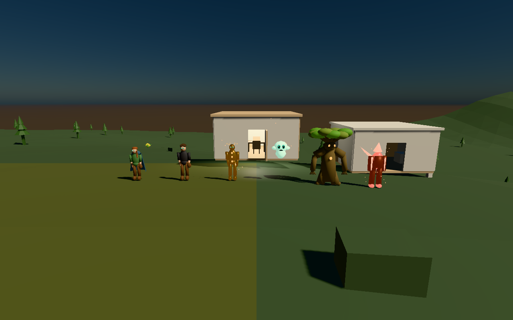
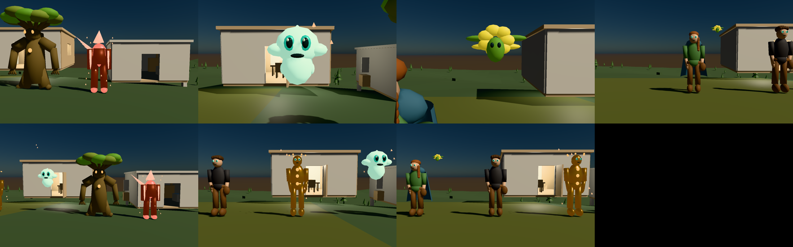

# V0 visual audit

Scope: a lean V0 before V1, as the roadmap requires. It covers the seven E1 founders' current published
assets, the Infinity renderer that must show them, a canonical benchmark and the
quality bar V1 is held to. Rule: **a Blender render that looks better than the
same asset in Infinity is not evidence. Acceptance is judged in Infinity.**

Sources (read-only): E1 private root `dev/civilization-os2-20261103/e1`
(Genesis CAS, SpatialDB publication `89c09a2c…7a`), E1 Core `33eb4b0`, E1
Infinity `eb3cd4a` and its sealed binary (`36180c05…4c00`). The world was copied
to `dev/v1-20261104/v0/e1-stage` and verified byte-identical
(generated `fb581a10…`, world `ab9d6830…`) before any run.

## Founders today (measured from the published bodies)

| Founder | Archetype | Height (m) | Joints | LOD0 parts / tris | LOD1 tris | Material zones | Emissive parts | Textures | Baked clips |
| --- | --- | --- | --- | --- | --- | --- | --- | --- | --- |
| Elara Vayne | humanoid | 1.705 | 6 | 14 / 3,332 | 1,412 | 8 | 2 | 0 | 0 |
| Auren | humanoid | 1.856 | 6 | 13 / 2,828 | 1,204 | 7 | 2 | 0 | 0 |
| Kai | synthetic_humanoid | 1.874 | 6 | 11 / 3,144 | 1,320 | 5 | 10 | 0 | 0 |
| Lumi | floating_spirit | 0.884 | 0 | 4 / 1,604 | 652 | 4 | 3 | 0 | 0 |
| Terra | nature_elemental | 2.904 | 4 | 8 / 3,612 | 1,788 | 4 | 3 | 0 | 0 |
| Ignis | fire_elemental | 2.288 | 6 | 14 / 1,336 | 680 | 3 | 14 | 0 | 0 |
| Melody Sprite | botanical_sprite | 0.211 | 0 | 4 / 1,680 | 672 | 3 | 3 | 0 | 0 |

All seven come from the reviewed E1 worker (`blender-universal/1`, Blender 5.2.2).
Each has a 145–391 KB untextured, unskinned single-material GLB proxy, a
source `.blend` in Genesis CAS, and a body of 0.2–0.8 MB. Animation is
E1's procedural expression kernel (idle, greet, observe, interact, speak,
locomote) posing rigid parts per joint on the CPU; there are no baked clips.
Full record: [founder audit](evidence/v0/founder-audit.json) (script
[audit-founders.py](evidence/v0/audit-founders.py)).

**Generated vs placeholder:** all are generated by the reviewed parameter
template, not placeholders. They are assembled ellipsoids, beams and cones with
visible part seams and flat per-part colour. Verdict: **Q1** for all seven (see
[standards](V0-VISUAL-QUALITY-STANDARDS.md)).

## Canonical benchmark (Infinity, Apple M1, Metal, 1280×800)

`bin/infinity --civilization-e1 e1-stage bench-full --capture`: recorded
playback of the gathering, 600 measured frames after 100 warm-up, while the Mac
was swapping about 6 GB.

| Metric | Value |
| --- | --- |
| Frame wall time p50 / p95 / max | 24.0 / 26.2 / 114.6 ms |
| GPU time p50 / p95 | 2.53 / 4.68 ms |
| Peak draw calls | 159 |
| Peak triangles | 28,548 |
| Texture memory | 0 B (no textures in the E1 body path) |
| Peak requested GPU asset bytes | 8,177,744 (geometry; 8 MiB budget) |
| Sampled peak RSS | 71.9 MB |
| Within p95 budget | yes |

Close-ups (`--focus=0..6`, 120 frames each) peak at 13,632–21,572 triangles
and 65–115 draw calls. Evidence: [report](evidence/v0/benchmark-full-report.json),
`before-focus-N.png`.

**Observations that matter for V1:** frame time is CPU-bound (render CPU p50
≈ 18 ms in E1; GPU ≈ 2.5 ms), so geometry can grow several-fold before the GPU
matters, while CPU posing and draw-call count scale with part count. Focus
framing sometimes leaves the subject at the edge or occluded (focus 2, the
sprite behind Elara). The sprite is 0.21 m tall and reads as a dot at gathering
distance.
