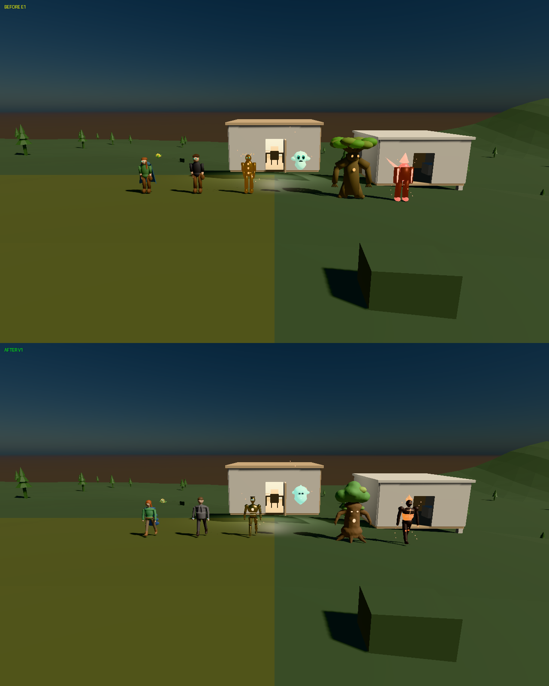

# V1 Founding Character Renaissance: acceptance

**Status: pipeline accepted end to end; visual target not met.** All seven
founders were rebuilt by reviewed Studio templates, admitted as reviewed E1
generator output, published through Genesis/SpatialDB with readback, rebound to
their **existing** identities on a byte-verified copy of the E1 world, verified
across restart, and rendered natively in Infinity on Metal within budget. Judged
in Infinity, **only Kai reaches Q2 (borderline)**. The Q2-for-all target is not
met; see the [quality review](V1-QUALITY-REVIEW.md). Nothing was merged or
deployed. The Infinity renderer was not changed.

## Exact revisions

| Item | Revision |
| --- | --- |
| Studio `feat/studio-v1` | templates `c1628e4e3f7`; Mac run in the commit that adds this file |
| Core `feat/e1-studio-generator-20261104` | `6ba5af4` (admission `3ed7cdc`, driver `5c04c72`, proxy import `6ba5af4`) |
| Infinity `feat/v1-founders-20261104` (local, not pushed) | `7afa69b` from E1 `eb3cd4a`; FinalStorm `05c79b3` unchanged; dependency check passes |
| SpatialDB | `bc510bda5310beecd8455ccece0ca5d3e3c43248`; fixture namespace `studio-v1-20261104` (own container; existing containers untouched) |
| Package authoring | upstream **Blender 5.2.2 LTS** `d13f752e3b9c`, OpenVDB on, EEVEE/Metal previews (Studio V1 build `c1628e4e3f71` lacks OpenVDB, whose pinned libraries are unfetched LFS pointers) |
| Planner | none needed for these reviewed-template plans; Gemma e4B remains the only local model |

## Results

| Gate | Result | Evidence |
| --- | --- | --- |
| Packages (7) | evaluation, hashes, S0 gate, E1 structural checks all pass; triangle counts identical to the cloud run | [studio-packages.json](evidence/v1/mac/studio-packages.json) |
| Blender reopen + GLB import (7) | each source reopens with founder, clips and rig; each GLB imports with matching clips (rigged: 1 armature; spirits: none) | [blender-reopen-glb-import.json](evidence/v1/mac/blender-reopen-glb-import.json) |
| Genesis ingest / owner authorization / gate | 7 × AwaitingAuthorization; gate digest `66bce7de85cb60fc79a3c89bef8f00ebb82ebe6e52b64a672d6eceb5452d1300` | [genesis-catalog.json](evidence/v1/mac/genesis-catalog.json), [reviews.json](evidence/v1/mac/reviews.json) |
| SpatialDB/PostGIS publication | root = readback `5f45eb19322a5ddd1ffc46fdb842c7b5459289f4821fab73a0e4e19736b8b6cf`; manifest `9e15b5b9d53a266ac43450f2a3ff199a1533b22fb42c1381dc7be858ffa1a563`; 64 assets; 32.7 s | [spatialdb-publication.json](evidence/v1/mac/spatialdb-publication.json) |
| World copy | byte-identical to accepted E1 world: 1,931 files, tree `ab9d6830fecc81946abe32fcb4fab0d291f2fc0a647c8e270c5a502337420d36`; original never opened | [world-copy.json](evidence/v1/mac/world-copy.json) |
| Rebind (owner-only, r3) | identities/entities reused; founder definitions, resources, memory hashes equal; 7 "resident cannot bind" refusals + "Lumi cannot walk"; 14 body-history entries; 0 model calls; 2.33 s | [v1-rebind.json](evidence/v1/mac/v1-rebind.json) |
| Restart persistence | positions, bindings and entity revisions equal; definitions, resources, memory equal; all bindings r3 | [v1-restart.json](evidence/v1/mac/v1-restart.json) |
| Audit | passes | [v1-audit.json](evidence/v1/mac/v1-audit.json) |
| Infinity native, correct archetypes | all 7 visible; bodies re-admitted at render time through `admit_studio_package`; spirits skeleton-free and floating; E1 per-archetype procedural motion (walk/greet joints, Lumi squash, Terra sway, flame/petal roles) | [infinity/](evidence/v1/mac/infinity) |
| Sustained performance (≥ 10 min, M1 rules) | **601.8 s, 133,700 frames: frame wall p50 5.17 / p95 9.53 ms (target 33.333 ms) — pass**; all spikes kept: 21 frames > 33.3 ms, 9 > 50 ms, max 103.7 ms; GPU p95 3.25 ms; 189 draw calls; 122,469 triangles; 8.07 MB requested GPU assets (≤ 8 MiB); RSS ≤ 91.8 MB | [sustained-report.json](evidence/v1/mac/infinity/sustained-report.json), [all frames](evidence/v1/mac/infinity/sustained-frame-profile.csv.gz) |
| Visual target Q2 for all seven | **not met**: Kai Q2 borderline; Ignis, Terra near Q2; Elara, Auren, Melody Q1+; Lumi Q1 with an eye-size regression | [quality review](V1-QUALITY-REVIEW.md) |

### Cost versus E1 (same Infinity binary, same Mac state)

E1 gathering: p50 3.81 / p95 7.72 ms, 159 draws, 28,548 triangles. V1 gathering:
p50 5.50 / p95 10.44 ms, 189 draws, 122,469 triangles, so about 1.35× the frame
time for 4.3× the triangles. The sealed E1 binary measured slower (p50 23.9 ms)
on the same machine, so the comparison uses the same V1 binary
([e1-full-samebinary-report.json](evidence/v1/mac/infinity/e1-full-samebinary-report.json)).

### Sizes

| Founder | Package | body.json | asset.glb | proxy.glb | LOD0 / LOD1 tris |
| --- | --- | --- | --- | --- | --- |
| Elara | 5.8 MB | 1,391,984 | 710,464 | 265,320 | 24,086 / 9,152 |
| Auren | 5.4 MB | 1,278,492 | 654,676 | 243,904 | 22,124 / 8,406 |
| Kai | 3.4 MB | 769,857 | 405,796 | 149,004 | 13,442 / 5,106 |
| Lumi | 1.4 MB | 395,922 | 134,464 | 76,804 | 6,748 / 2,564 |
| Terra | 4.8 MB | 1,128,904 | 568,636 | 212,148 | 19,323 / 7,342 |
| Ignis | 4.1 MB | 953,451 | 490,432 | 181,060 | 16,488 / 6,264 |
| Melody Sprite | 1.8 MB | 537,420 | 182,188 | 105,904 | 9,246 / 3,512 |

## Before / after

Close-ups: [before-after-closeups.png](evidence/v1/mac/before-after-closeups.png).

## Limits

The E1 character path renders untextured rigid parts (V0 matrix). Studio's
skinned clips are authoring data; Infinity animates with E1's procedural kernel.
The private V1 root and PostGIS fixture stay on this Mac. Packages are
deterministic across the cloud and this Mac (identical triangle counts), but
Blender `.blend` bytes differ by platform/version. Follow-ups:
[V1 → V2 handoff](V1-V2-HANDOFF.md).
