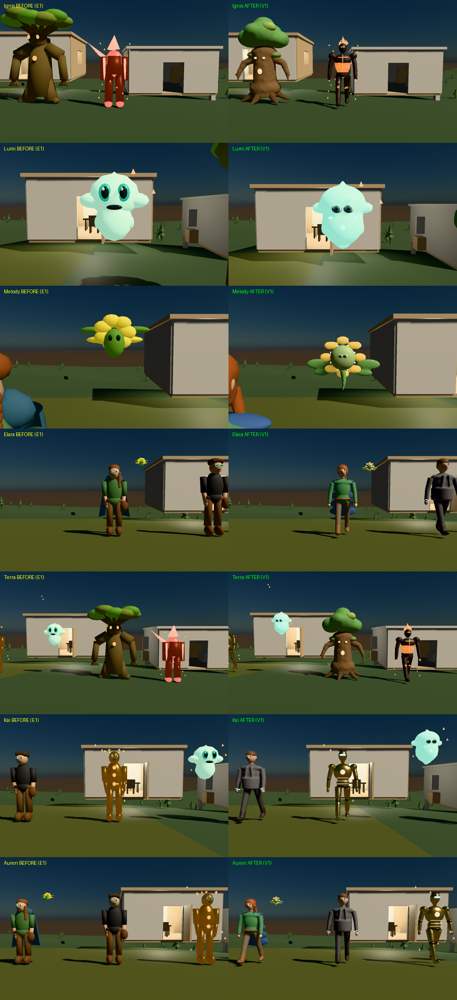

# V1 quality review (judged in Infinity, per the V0 rule)

All judgments use the **Infinity Metal captures** of the rebound world
(`--civilization-v1`, unchanged FinalStorm renderer). Studio previews are not
evidence. Tiers are those of [V0 standards](V0-VISUAL-QUALITY-STANDARDS.md).

Images: [close-ups before/after](evidence/v1/mac/before-after-closeups.png) ·
[gathering before/after](evidence/v1/mac/before-after-gathering.png) ·
individual frames in `evidence/v1/mac/infinity/`.

| Founder | E1 tier | V1 tier (Infinity) | What improved | What still falls short |
| --- | --- | --- | --- | --- |
| **Kai** | Q1 | **Q2 (borderline pass)** | articulated gold plating, dark joint rings, cyan visor, amber energy core and seams; reads as a mechanical synthetic, no longer a "gingerbread" figure | head/visor small at gathering distance; no panel-line detail |
| **Ignis** | Q1 | **Q1+ / near Q2** | dark forged armour with molten orange core and luminous seams; flame plumes on the helm | plumes read small; armour reads as a dark suit more than forged plates; flames' E1 flicker is subtle |
| **Terra** | Q1 | **Q1+ / near Q2** | fused bark trunk, splayed roots, branch arms, amber eyes and heart, layered canopy with highlights | bark relief is soft at distance; moss barely reads |
| **Melody Sprite** | Q1 | **Q1+** | eight-petal flower, leaf wings, face disk with eyes, bioluminescent dots | still 0.26 m: small at its focus camera; petal colour slightly pale |
| **Elara** | Q1 | **Q1+** | smooth seamless body, green tunic, belt and satchel, auburn hair and braid, boots; colours read correctly | face is tiny dot eyes (mannequin); the blue cloak reads only at the sides; hair volume modest |
| **Auren** | Q1 | **Q1+** | charcoal jacket over dark layers, discreet luminous trim and cuffs, wavy hair; canon's "no armour" respected | mannequin face; jacket lapels barely read |
| **Lumi** | Q1 | **Q1 (regression on face)** | one continuous floating body with crown and fins, softer glow (S2's over-bright look is fixed) | **eyes render as small dots, smaller and less expressive than E1's large eyes**; canon demands large expressive eyes |

**Result: 1 of 7 at Q2 (Kai, borderline). V1's Q2 target for all seven is
not met.** Every founder's geometry improved (fused, seamless forms; 2–5× the
triangles), and colours are **not** washed out in Infinity. The pale look in the
cloud and Studio previews came from preview lighting, not from the assets. The
remaining gap is art direction: faces, readable secondary forms and scale. That
is not a renderer limitation.

No art pass was made. The brief made the bounded palette/cloak pass conditional
on washed-out colour in Infinity, and Infinity shows correct colour. The concrete
art fixes needed are listed in the [V2 handoff](V1-V2-HANDOFF.md).
